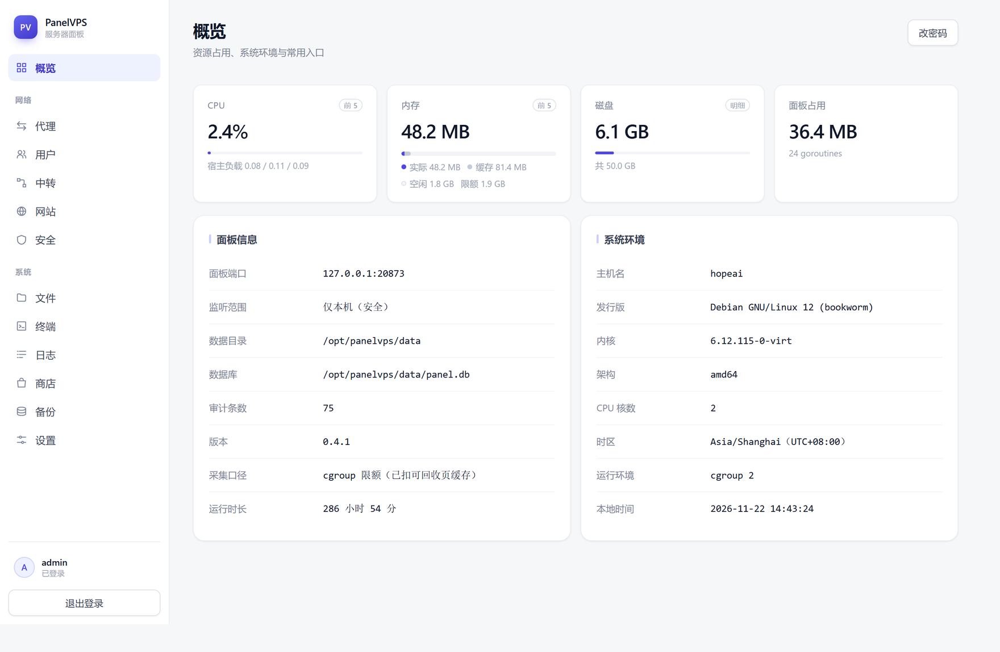
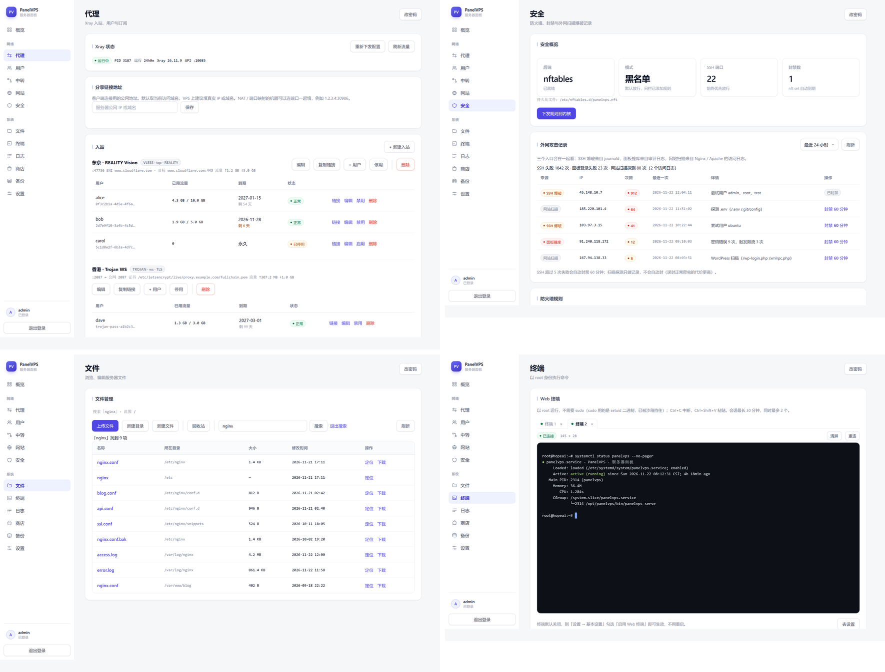

# PanelVPS

> 把 VPS 日常运维和 Xray 代理管理装进一个网页 —— 只有一个 13MB 的二进制，
> 空载内存 <50MB，一条命令 10 秒装好。

[](https://github.com/Everything-is-one/panelvps/actions/workflows/ci.yml)
[](LICENSE)
[](https://go.dev/)
[](#安装)

<p align="center">
  
</p>

## 为什么是它

- **一个文件，没有依赖**：`go build` 出来的静态二进制，前端资源编译时打包进去，数据存
  SQLite。不用装 Docker、Python、Node，也没有一堆容器要维护。
- **小内存机器也跑得动**：空载 <50MB，512MB 的机器上还能留出空间跑站点和代理。
- **装得快**：脚本自动识别架构、校验 SHA256、配好 systemd，10 秒内打印初始密码。默认只
  监听 `127.0.0.1`，不裸奔。
- **不用再装 x-ui**：VLESS / VMess / Trojan / Shadowsocks 多用户、流量统计、配额与到期、
  分享链接与二维码，全在一个页面里。

## 能做什么

- **代理 / 用户 / 中转** —— Xray 入站与多用户（VLESS / VMess / Trojan / SS）、流量配额与
  到期、分享链接与二维码；跨入站用户总表，按到期 / 超额 / 停用筛查；TCP / UDP 端口转发，
  带实时上下行与连接数。
- **概览** —— CPU / 内存 / 磁盘实时趋势；内存把「实际占用 / 可回收缓存 / 空闲」分段标出，悬停还能看到「实际占用」由进程匿名、tmpfs、内核、其它各占多少
  （宿主机与 cgroup 两种口径都扣掉可回收缓存）；磁盘卡直接
  显示哪个目录占空间，点开逐层下钻到具体文件。
- **文件 / 终端** —— 浏览编辑、上传下载、打包解压、回收站、按文件名搜索子目录；xterm.js +
  PTY，双标签独立会话，切走不断、断线重连。
- **网站 / 安全** —— 静态 / PHP 建站、Nginx 配置生成与下发、证书申请；nftables / iptables
  双后端、规则下发、SSH 爆破自动封禁（超阈值直接永久封禁）、攻击记录带来源归属地与网站
  扫描；登录入口支持访问后缀，直接敲 `/` 只会得到 404。
- **日志 / 商店 / 备份 / 设置** —— 六个固定来源尾部读取；12 个软件的声明式清单、步骤可
  预览、失败回滚；数据库一致性快照与恢复；端口、告警、自更新、服务单元自检。

界面是左侧导航 + 卡片布局，内容区最宽 1280px 居中，桌面与手机都能用。命令行敲
`panelvps` 还有一个数字菜单，负责启停、改端口、重置密码、开 BBR、改 SSH 端口与访问后缀、
重启服务器。

## 安装

Debian 12 / Ubuntu 22.04+，amd64 与 arm64 均支持：

```bash
curl -fsSL https://raw.githubusercontent.com/Everything-is-one/panelvps/main/deploy/bootstrap.sh | sudo bash
```

脚本会下载对应架构的二进制、校验 SHA256、装好 systemd 服务，最后把初始密码打印出来。
默认只监听 `127.0.0.1:20873`，用 SSH 隧道访问：

```bash
ssh -L 20873:127.0.0.1:20873 root@<服务器IP>
# 浏览器打开 http://127.0.0.1:20873
```

想用 `IP:端口` 直接打开，加 `--public`；锁定版本、容器环境、国内自建分发源等细节见
[docs/install.md](docs/install.md)。

> 面板自己不做 HTTPS。公网直连请在前面套一层 TLS 反向代理，或至少用 16 位以上随机密码，
> 并只放行自己的出口 IP。

## 界面

<p align="center">
  
</p>

## 文档

| 文件 | 内容 |
|---|---|
| [docs/install.md](docs/install.md) | 安装、锁定版本、LXC / 容器、自建分发、管理菜单、验收测试 |
| [docs/operations.md](docs/operations.md) | 各模块实现契约、systemd 沙箱、BBR、代理连不上排查、实测记录 |
| [docs/api.md](docs/api.md) | HTTP 接口：控制、代理、中转 |
| [PROVENANCE.md](PROVENANCE.md) | 代码来源与许可合规记录 |

## 从源码构建

```bash
go build -trimpath -ldflags "-s -w" -o bin/panelvps ./cmd/panelvps
./bin/panelvps serve        # 首次启动会打印初始密码，只打印一次、不落盘
```

交叉编译两个架构：`./scripts/build.sh`。

```
cmd/panelvps/     CLI 入口（serve / init / info / reset-password / relay）
internal/         认证、文件沙箱、防火墙、Xray、站点、商店、备份、自更新…
web/              embed 的前端（零构建原生 JS + xterm.js）
deploy/           systemd 单元、容器覆盖、安装与引导脚本
scripts/          构建、发布、冒烟测试、UI 自测
```

## 许可

[Apache License 2.0](LICENSE)。可商用、修改、闭源分发，需保留版权与许可声明。
洁净室实现，未复制 GPL 代码，详见 [PROVENANCE.md](PROVENANCE.md)。

## 参与

- **安全问题**：请不要开 public issue，走 GitHub 私有漏洞报告（Security → Report a vulnerability）
- **功能与缺陷**：issue 里附上发行版、架构、`panelvps info` 输出与相关日志
- **代码**：fork → 分支 → PR，提交前跑 `go vet ./...`、`go test ./...`、
  `python -m py_compile scripts/smoke_test.py`
